# Alerta Cidadão

Aplicativo mobile em Flutter que transforma a previsão do tempo em **alertas simples e orientações práticas** para a população: calor extremo, chuva forte e risco de alagamento, ventania, radiação UV e frio intenso.

## Desenvolvedores

| Nome completo | RM |
|---|---|
| Felipe Teixeira | 556100 |
| Maria Eduarda de Araujo Fernandes | 554543 |
| Gustavo Oda | 556754 |

## Tema da Global Solution

**Desafio FIAP 2026.2: CitizenTech**, tecnologias criadas a partir das necessidades reais das pessoas.

O projeto parte de uma das sugestões do briefing: *sistemas de previsão de enchentes, deslizamentos, incêndios e ondas de calor com alertas direcionados à população*.

**ODS relacionados:** 3 (Saúde e bem-estar), 10 (Redução das desigualdades), 11 (Cidades e comunidades sustentáveis) e 13 (Ação contra a mudança global do clima).

## Descrição da solução

Eventos climáticos extremos estão mais frequentes no Brasil, e quem mais sofre com eles costuma ser quem tem menos acesso a informação clara. A previsão do tempo existe, mas chega como números técnicos (milímetros de chuva, índice UV, km/h de vento) que pouca gente sabe interpretar.

O Alerta Cidadão consulta a previsão de 7 dias de uma cidade, aplica regras de risco e devolve:

- o **risco geral da semana** (baixo, moderado ou alto);
- **alertas em linguagem simples**, dizendo o que vai acontecer, quando e o que fazer;
- um **guia de proteção** com orientações para antes, durante e depois de cada tipo de evento;
- os **telefones de emergência** (Defesa Civil 199, Bombeiros 193, SAMU 192).

## Fluxo de telas

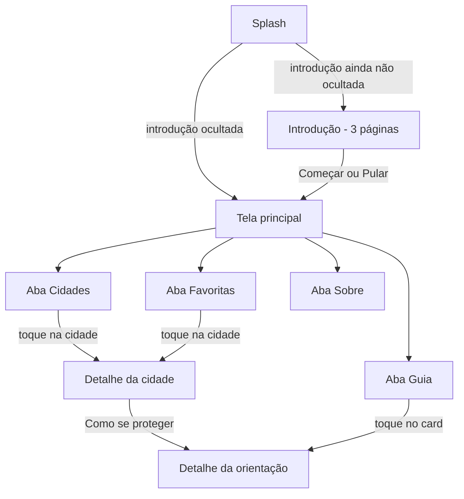

| Tela | O que faz |
|---|---|
| Splash | Mostra o logo e decide, via SharedPreferences, se abre a introdução ou a tela principal |
| Introdução | 3 páginas com ícone, título e descrição; botões Voltar e Avançar; opção "Não mostrar novamente" |
| Cidades | Lista de cidades com busca por nome ou UF, filtro por região e botão de favoritar |
| Favoritas | Cidades salvas pelo usuário (persistidas com SharedPreferences) |
| Detalhe da cidade | Consome a API, mostra clima atual, risco da semana, alertas e previsão de 7 dias |
| Guia | Telefones de emergência (toque para copiar) e cards de orientação em grade |
| Detalhe da orientação | Orientações de antes, durante e depois em seções expansíveis |
| Sobre | Propósito, ODS, equipe, fonte de dados e opção de reativar a introdução |

## Prints das telas

Capturas feitas no emulador Android (Pixel 7).

### Splash e introdução
| Splash | Introdução 1 | Introdução 2 | Introdução 3 |
|---|---|---|---|
| 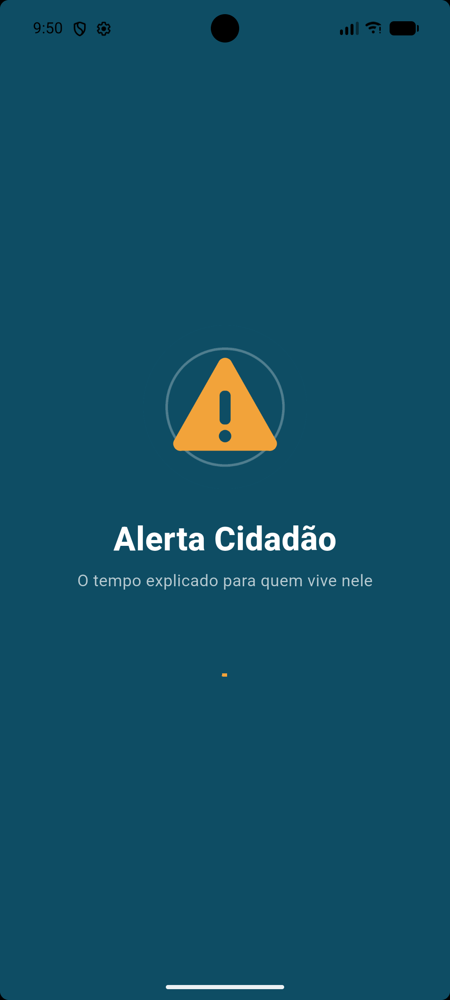 | 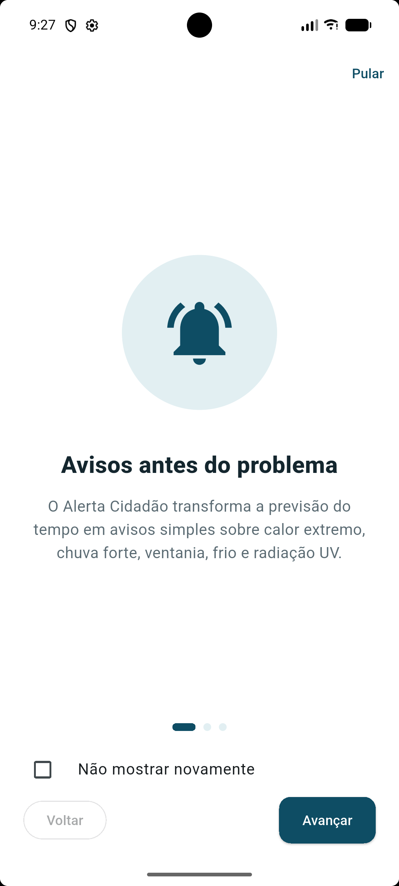 | 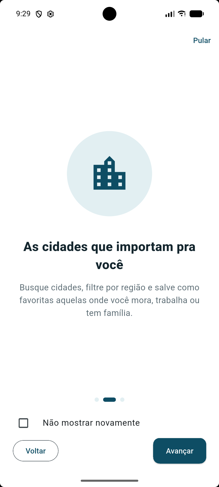 | 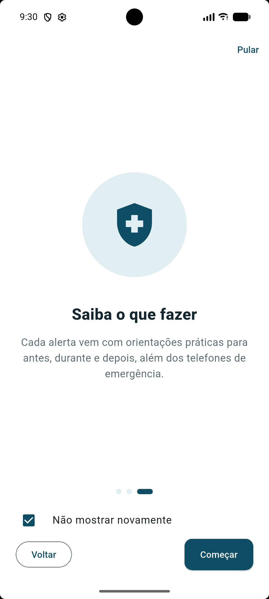 |

### Cidades e detalhe
| Lista com favoritas | Busca | Detalhe (topo) | Detalhe (previsão) |
|---|---|---|---|
| 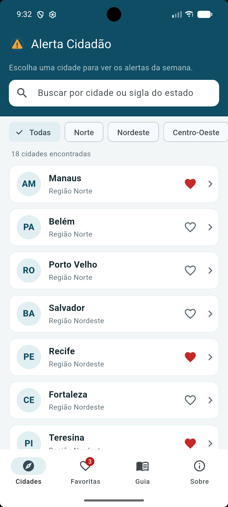 | 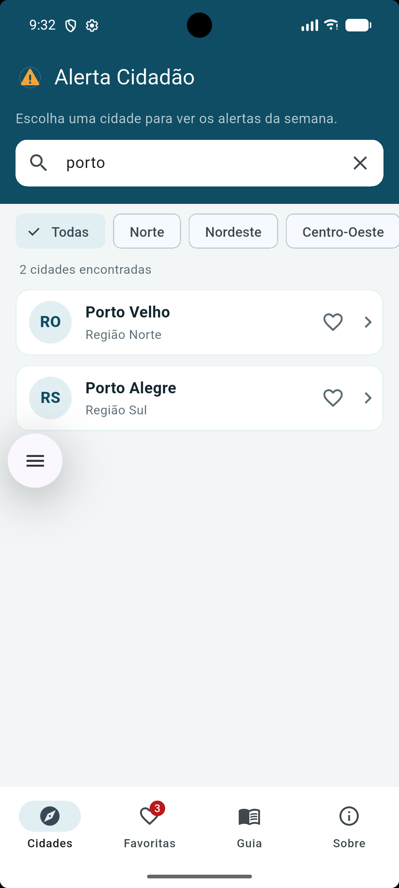 | 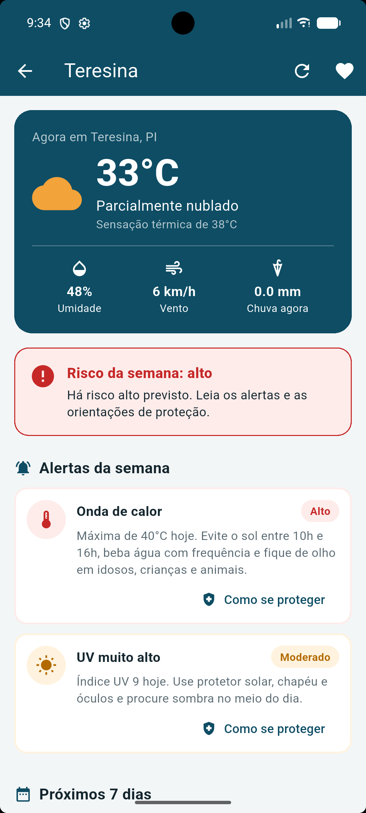 | 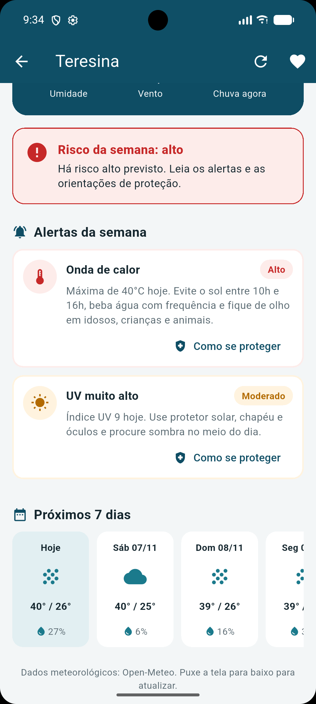 |

### Orientação, erro e favoritas
| Como se proteger | Erro com nova tentativa | Favoritas |
|---|---|---|
| 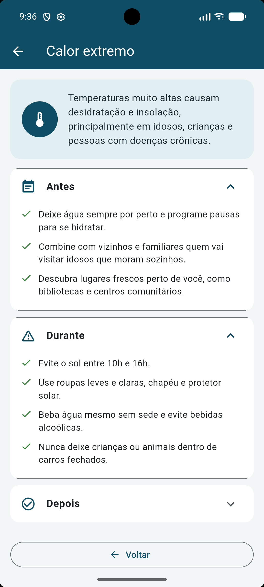 | 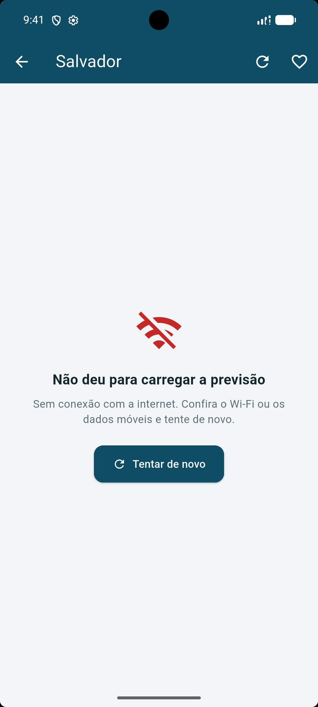 | 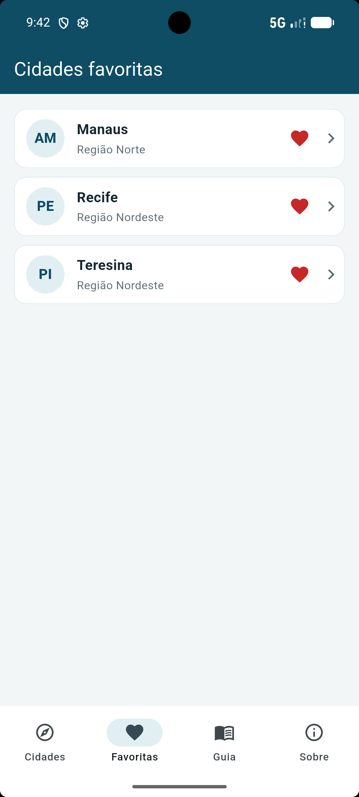 |

### Guia e sobre
| Guia (emergência) | Guia (orientações) | Sobre (propósito) | Sobre (equipe) |
|---|---|---|---|
| 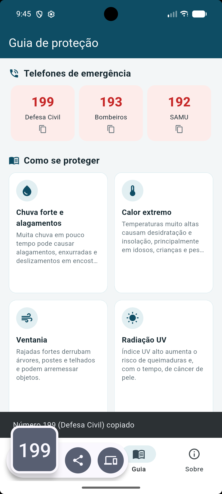 | 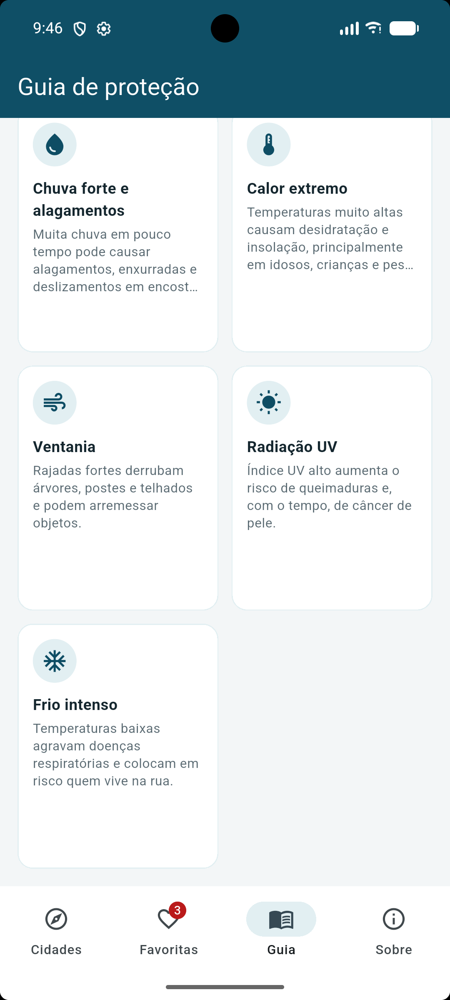 | 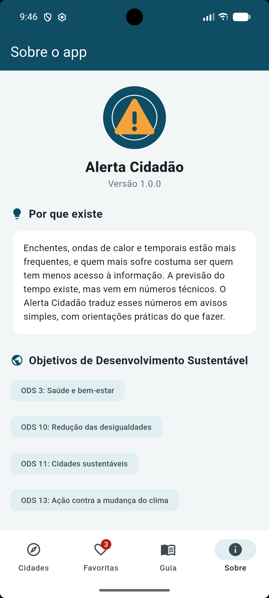 | 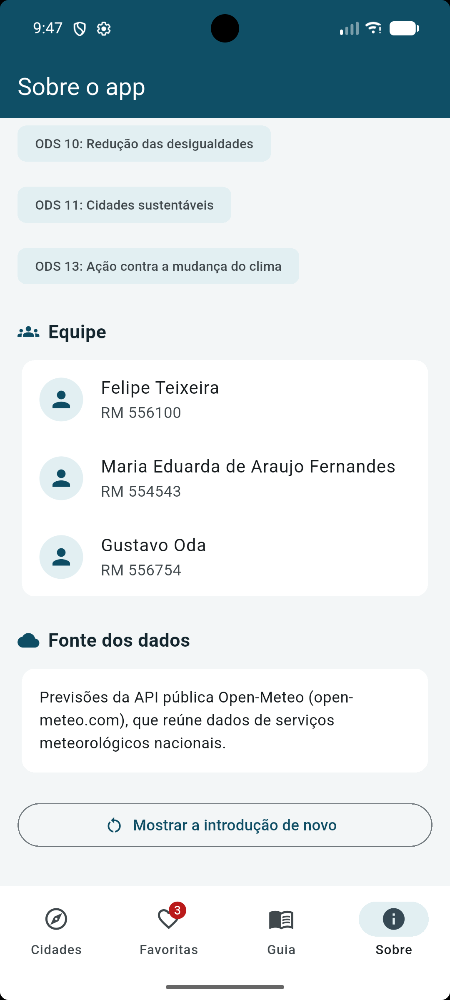 |

## API utilizada

**Open-Meteo Forecast API**, pública, gratuita e sem chave de acesso: <https://open-meteo.com>

Endpoint consumido: `GET https://api.open-meteo.com/v1/forecast`

Parâmetros enviados: `latitude`, `longitude`, `current` (temperatura, sensação térmica, umidade, precipitação, código do tempo e vento), `daily` (código do tempo, máxima, mínima, chuva acumulada, probabilidade de chuva, vento máximo e índice UV), `timezone=auto` e `forecast_days=7`.

O JSON recebido é convertido nos models `PrevisaoClima`, `CondicaoAtual` e `PrevisaoDia` (pasta `lib/models`).

### Regras de risco (`lib/services/alerta_service.dart`)

| Risco | Moderado | Alto |
|---|---|---|
| Calor (máxima) | a partir de 32 °C | a partir de 35 °C |
| Chuva (acumulado do dia) | a partir de 25 mm | a partir de 50 mm |
| Vento (máximo) | a partir de 40 km/h | a partir de 60 km/h |
| Índice UV | a partir de 8 | a partir de 11 |
| Frio (mínima) | até 10 °C | até 5 °C |

## Arquitetura

O projeto separa interface, modelos, regras de negócio e acesso a dados:

```
lib/
├── main.dart              ponto de entrada
├── app.dart               MaterialApp, tema e rotas
├── core/                  cores, rotas nomeadas, utilitários e enum de estados
├── models/                classes de dados (Cidade, PrevisaoClima, Alerta, Dica...)
├── data/                  dados fixos do app (cidades, orientações, equipe)
├── repositories/          acesso e filtragem dos dados locais
├── services/              API (http), regras de alerta e SharedPreferences
├── screens/               telas (Stateful e Stateless)
└── widgets/               componentes reutilizáveis
```

- **Telas** só montam a interface e reagem a ações. Elas não calculam nada.
- **Services** concentram a lógica: `ClimaService` faz a requisição HTTP e trata erros, `AlertaService` aplica as regras de risco, `PreferenciasService` e `FavoritosService` cuidam da persistência local.
- **Repositories** fornecem e filtram os dados locais (busca e região).
- **Gerenciamento de estado** com `setState`. Os favoritos ficam na `PrincipalScreen`, que repassa o estado e os callbacks para as abas e para o detalhe.
- **Estados do WebService** representados pelo enum `EstadoCarregamento` (`inicial`, `carregando`, `sucesso`, `erro`), cada um com um widget próprio (`EstadoVazio`, `EstadoCarregando`, `EstadoErro`).
- **Navegação** com rotas nomeadas e `onGenerateRoute`. As telas de detalhe recebem parâmetros via `arguments` (`DetalheCidadeArgs` e `Dica`).

### Widgets reutilizáveis

`CidadeCard`, `AlertaCard`, `PrevisaoDiaCard`, `DicaCard`, `ContatoEmergenciaCard`, `CabecalhoClima`, `NivelRiscoBanner`, `NivelChip`, `InfoItem`, `SecaoTitulo`, `EstadoCarregando`, `EstadoErro`, `EstadoVazio`, `PaginaIntroducaoView` e `IndicadorPaginas`.

### Interações implementadas

1. Toque em uma cidade abre o detalhe (com passagem de parâmetro).
2. Busca por nome ou UF e filtro por região.
3. Favoritar e desfavoritar, com o coração mudando de cor e contador na aba.
4. Atualizar a previsão pelo botão da barra ou puxando a tela para baixo.
5. "Como se proteger" leva do alerta à orientação correspondente.
6. Toque no telefone de emergência copia o número.
7. Seções expansíveis de antes, durante e depois.

## Vídeo pitch

**Link (YouTube, público):** COLE_AQUI_O_LINK_DO_VIDEO

Vídeo de até 5 minutos, gravado e narrado pela equipe, com pelo menos metade do tempo mostrando o aplicativo funcionando.

## Como executar

Pré-requisitos: Flutter 3.22 ou superior, Android Studio e um emulador Android (ou celular com depuração USB).

```bash
# dentro da pasta do projeto
flutter pub get
flutter run
```

Antes do `flutter run`, deixe o emulador aberto e selecione o dispositivo Android (no Android Studio, no menu ao lado do botão de play). Se aparecer "Windows (desktop)" ou "Chrome (web)", troque para o emulador.

Se a pasta `android/` não existir (por exemplo, ao usar uma cópia só com o código), gere as pastas de plataforma antes, sem sobrescrever nada do projeto:

```bash
flutter create . --project-name alerta_cidadao --org br.com.fiap
```

**Windows com o projeto fora do disco C:** se o build falhar com a mensagem `this and base files have different roots`, adicione a linha abaixo no final de `android/gradle.properties` e rode `flutter clean` e `flutter pub get` antes de executar de novo. Ela só desliga o cache incremental do Kotlin e não muda nada no app.

```
kotlin.incremental=false
```

Para rodar os testes de unidade (conversão do JSON e regras de alerta):

```bash
flutter test
```
